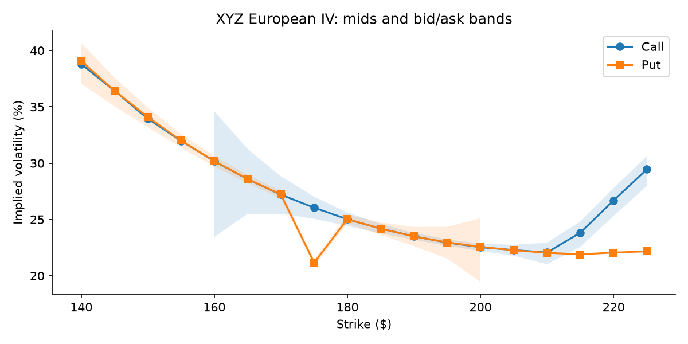
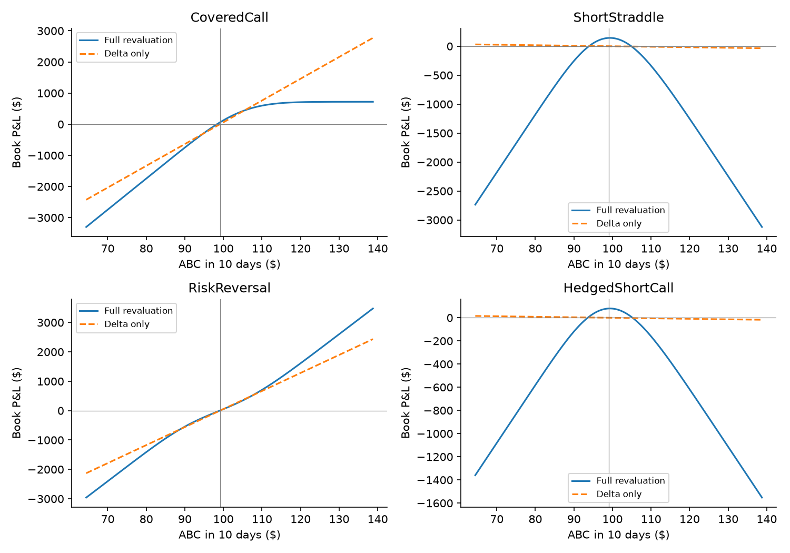
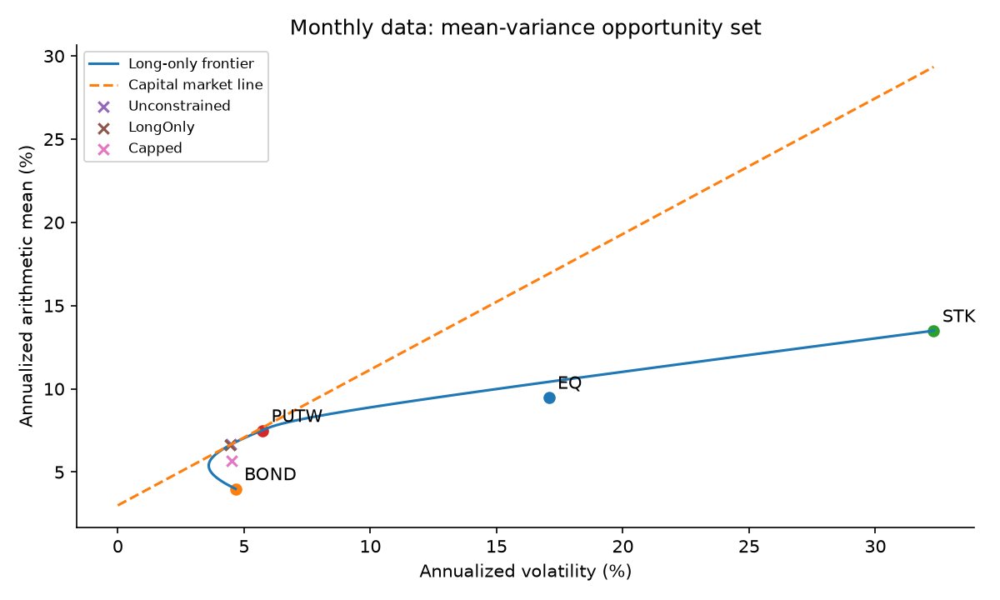

Haolun Wu | FinTech 545 | November 11, 2026

## Methods and conventions

This report answers every Predict, Fit, and Reconcile part. Predictions were recorded in Codes/predictions.md after the allowed descriptive calculations and before the full fits. The calculations import my existing FunctionalTest library directly. I extend my cash-dividend CRR code to European exercise and use a vectorized version of my GBSM formula for simulation.

Returns are arithmetic. Variance and standard deviation use n-1 except normal maximum-likelihood sigma for AICc. Skewness and excess kurtosis use empirical central moments; ordinary kurtosis equals the reported excess plus three. Risk is expressed as positive losses: VaR = -q_alpha(P&L) and ES = minus the average of the worst alpha fraction. Historical ES includes fractional boundary mass. Rates and returns in CSV output are decimals.

Problem 1 uses the assignment valuation date November 13, 2026, even though this report is prepared November 11; maturity is 35/365 years. Problem 2 uses the supplied year fractions. Problem 3 uses 255 trading days/year, 30-day initial options and a 10-day horizon. For Problem 4 I use monthly rf = .03/12, with arithmetic annual means and square-root-of-12 volatility. Problem 5 uses 255 trading days/year, stated explicitly because no annualization count is specified there. Annual expected returns are arithmetic estimates, not guaranteed compounded growth.

One million option-book scenarios use seed 54503, independent daily shocks, and common uniforms for comparing normal and Student t. Both simulated return locations are reset to zero while each fitted scale is retained. Implied volatilities remain fixed; this is a spot-risk exercise, not a volatility-shock model. The 500 month-bootstrap portfolios use seed 54504.

## Reproducibility

From the repository root run: bash Assignments/Assignment3/Codes/run_all.sh. This recreates the result tables, plots, numerical validation, Ans.md, and Ans.pdf. Detailed commands, assumptions, library dependencies, and verification are in Assignment3/README.md. The CSVs preserve more precision than the tables printed here.

All original input files remain unchanged. Canvas submission and the final "done" response are separate from this local deliverable.

# 1. Implied volatility from a dirty chain

## Predict: (a) parity at every strike

For European options, C - P = S exp(-qT) - K exp(-rT). Define gap = C_mid - P_mid - S exp(-qT) + K exp(-rT). I use the prompt's flag band, the sum of the full call and put bid-ask spreads. This is deliberately more conservative than the executable half-sum test around mids. The table is in dollars.

| Strike | Parity gap | Spread band | Flag |
| --- | --- | --- | --- |
| 140 | -0.00447 | 1.40 | False |
| 145 | +0.00019 | 1.25 | False |
| 150 | -0.00515 | 1.10 | False |
| 155 | -0.00048 | 0.95 | False |
| 160 | -0.00082 | 0.83 | False |
| 165 | -0.00115 | 0.69 | False |
| 170 | -0.00149 | 0.59 | False |
| 175 | +0.88818 | 0.47 | True |
| 180 | -0.00216 | 0.43 | False |
| 185 | +0.00251 | 0.44 | False |
| 190 | +0.00217 | 0.46 | False |
| 195 | -0.00316 | 0.53 | False |
| 200 | -0.00350 | 0.65 | False |
| 205 | +0.00117 | 0.78 | False |
| 210 | +0.00083 | 0.92 | False |
| 215 | +0.03550 | 1.05 | False |
| 220 | +0.06016 | 1.20 | False |
| 225 | +0.06983 | 1.36 | False |

Only K=175 is flagged: +$0.88818 versus $0.47. At least one side there is stale or erroneous; parity cannot identify the bad quote by itself. This is an internal pricing inconsistency, not evidence of two different economically valid volatilities for the same strike and maturity. Fees, execution, and synchronization still matter for an actual trade.

## Predict: (b)-(c) common IV and reliability

At a common sigma, C(sigma)-P(sigma) is exactly the parity forward value. Thus if observed prices satisfy parity and one price has an IV, the other price is reproduced at that same IV. Strictly positive vega makes this solution unique. Small tick-rounding gaps can still lead to noticeably different inverted IVs when vega is tiny.

Since d sigma/d price = 1/vega, I expect the far wings to be least reliable. Deep-ITM calls have very small time value relative to their spreads; far-OTM calls above 210 all show the same $0.05/$0.10 floor despite increasing strikes. Their rising mid-IV can therefore be mechanical. Deep-ITM puts are also unreliable: their price is mostly intrinsic/forward value, leaving little time value to invert.

# 1. Fit: (d)-(e) every quote and vega

I invert my GBSM price with Brent root finding. The lower bound is max(S exp(-qT)-K exp(-rT),0) for a call and its sign-reversed counterpart for a put. Quotes below this bound have no nonnegative IV. Upper bounds are S exp(-qT) and K exp(-rT). All mids and asks are valid here. The 140, 145, 150, 155 call bids and 205 through 225 put bids are below their lower bounds and have no IV; n/a below is intentional.

IV columns are percentages. Vega is dollars per 1.00 change in sigma for one option on one share, not dollars per volatility point. The last column is the local change in percentage points of IV for a one-cent price change: 100(0.01/vega). It is a derivative approximation; full bid/ask inversion captures nonlinearity.

| Type | Strike | Bid IV % | Mid IV % | Ask IV % | Vega | 1 cent: vol pts |
| --- | --- | --- | --- | --- | --- | --- |
| Call | 140 | n/a | 38.799 | 56.470 | 1.6318 | 0.6128 |
| Call | 145 | n/a | 36.433 | 49.974 | 2.3732 | 0.4214 |
| Call | 150 | n/a | 33.951 | 43.947 | 3.3902 | 0.2950 |
| Call | 155 | n/a | 31.983 | 38.799 | 5.0566 | 0.1978 |
| Call | 160 | 23.441 | 30.173 | 34.621 | 7.4599 | 0.1340 |
| Call | 165 | 25.502 | 28.582 | 31.258 | 10.7449 | 0.0931 |
| Call | 170 | 25.502 | 27.205 | 28.829 | 14.7579 | 0.0678 |
| Call | 175 | 25.058 | 26.046 | 27.022 | 18.8417 | 0.0531 |
| Call | 180 | 24.424 | 25.021 | 25.617 | 21.8006 | 0.0459 |
| Call | 185 | 23.768 | 24.192 | 24.616 | 22.3970 | 0.0446 |
| Call | 190 | 23.205 | 23.504 | 23.802 | 20.1044 | 0.0497 |
| Call | 195 | 22.657 | 22.947 | 23.233 | 15.6218 | 0.0640 |
| Call | 200 | 22.198 | 22.536 | 22.865 | 10.5050 | 0.0952 |
| Call | 205 | 21.786 | 22.286 | 22.757 | 6.1876 | 0.1616 |
| Call | 210 | 21.031 | 22.067 | 22.937 | 3.1927 | 0.3132 |
| Call | 215 | 22.562 | 23.823 | 24.827 | 2.2580 | 0.4429 |
| Call | 220 | 25.314 | 26.689 | 27.781 | 2.0733 | 0.4823 |
| Call | 225 | 27.965 | 29.447 | 30.623 | 1.9250 | 0.5195 |
| Put | 140 | 37.044 | 39.069 | 40.679 | 1.6886 | 0.5922 |
| Put | 145 | 35.051 | 36.425 | 37.607 | 2.3710 | 0.4218 |
| Put | 150 | 33.187 | 34.102 | 34.936 | 3.4441 | 0.2904 |
| Put | 155 | 31.383 | 31.993 | 32.571 | 5.0609 | 0.1976 |
| Put | 160 | 29.708 | 30.184 | 30.646 | 7.4655 | 0.1339 |
| Put | 165 | 28.217 | 28.593 | 28.962 | 10.7504 | 0.0930 |
| Put | 170 | 26.875 | 27.215 | 27.552 | 14.7621 | 0.0677 |
| Put | 175 | 20.874 | 21.162 | 21.448 | 17.4008 | 0.0575 |
| Put | 180 | 24.641 | 25.031 | 25.420 | 21.8009 | 0.0459 |
| Put | 185 | 23.623 | 24.181 | 24.739 | 22.3968 | 0.0446 |
| Put | 190 | 22.644 | 23.493 | 24.335 | 20.1020 | 0.0497 |
| Put | 195 | 21.522 | 22.967 | 24.343 | 15.6327 | 0.0640 |
| Put | 200 | 19.445 | 22.569 | 25.106 | 10.5300 | 0.0950 |
| Put | 205 | n/a | 22.267 | 26.862 | 6.1734 | 0.1620 |
| Put | 210 | n/a | 22.041 | 29.777 | 3.1774 | 0.3147 |
| Put | 215 | n/a | 21.901 | 33.586 | 1.4603 | 0.6848 |
| Put | 220 | n/a | 22.062 | 37.925 | 0.6582 | 1.5193 |
| Put | 225 | n/a | 22.168 | 42.435 | 0.2716 | 3.6815 |

# 1. Reconcile: (f)-(h)

The shaded regions show bid/ask IV ranges where they exist; a missing bound means no IV at that quote. At K=175, call mid IV is 26.0457% and put mid IV 21.1620%, a 4.8837-point gap. Dividing the parity error by put vega gives 100(.88818/17.40083)=5.1042 vol points; call vega gives 4.7139 points. Using their average vega gives 4.9013 points, close to the actual gap. The difference is expected because vega changes across this finite volatility move. The isolated put dip is the visible parity anomaly; comparison with neighbouring strikes suggests the put quote is the likely bad side, though parity alone is symmetric.

The call wing rises from 22.067% at 210 to 23.823%, 26.689%, and 29.447% at 215, 220, 225. The three latter mids are all $0.075. A one-cent move means .443, .482 and .519 IV points, and their bid/ask ranges are 22.562%-24.827%, 25.314%-27.781%, and 27.965%-30.623%. Those ranges are not an uncertainty estimate for a clean volatility surface: both bid and ask are pinned to the same quote floor, so even the whole interval is distorted. Deep-ITM put IV is more fragile still: at 225 a cent is 3.682 points.

Parity does not catch this wing problem because its dollar gaps (.0355, .0602, .0698) are far smaller than its bands (1.05, 1.20, 1.36). A small OTM price error is a large fraction of time value but tiny beside the ITM put spread. Parity tests cross-contract dollar consistency; it does not certify useful time-value precision.

Ignoring the 175 anomaly and the floored far call wing, the surface is a pronounced downside skew: IV is about 39% at 140, 30% at 160, 25% around 180, and 22% around 205-210. Relative to upside optionality, downside protection commands a premium. This is consistent with insurance demand and downside-tail risk rather than a symmetric lognormal market; the extreme left measurements themselves still have low vega and broad uncertainty.

# 2. American options and discrete dividends

## Predict: (a)-(b) timing and direction

| Dividend | Amount | K(1-exp(-r*remaining)) | D2 exercise boundary |
| --- | --- | --- | --- |
| 1 | 0.25000 | 0.89195 | n/a |
| 2 | 1.50000 | 0.22449 | 52.72485 |

At t=.10, .25 < .89195, so the stated call-exercise condition fails. At t=.40, 1.50 > .22449, so exercise can be optimal sufficiently far in the money. The condition is necessary, not a claim that every call should be exercised. Before pricing, I predicted dividends lower both call values, raise both put values, increase the call exercise premium, and reduce the put premium by making waiting for the stock-price drop more valuable.

## Fit: (c) values with and without cash dividends

| Option | NoDividends | NoDividendTree | Dividends | PVApprox |
| --- | --- | --- | --- | --- |
| EuropeanCall | 3.922268 | 3.917604 | 3.175174 | 3.072293 |
| AmericanCall | 3.917604 | 3.917604 | 3.467544 | n/a |
| EuropeanPut | 4.309830 | 4.305166 | 5.284855 | 5.181974 |
| AmericanPut | 4.435280 | 4.435280 | 5.371135 | n/a |

NoDividends uses GBSM for Europeans and the N=200 tree for Americans. NoDividendTree gives the common-grid European comparison too. Dividends uses the non-recombining N=200 cash tree in all four cases. The stock jumps down by each cash dividend; I restart each subtree at that ex-dividend spot and retain every resulting branch. American nodes compare exercise at the cum-dividend spot against discounted continuation; European nodes never exercise early.

The PV approximation subtracts .25 exp(-.045*.1)+1.50 exp(-.045*.4) from spot and uses ordinary GBSM. It gives call 3.072293 and put 5.181974, both about .102881 below the cash-tree values. It fixes the forward level but treats the entire dividend-adjusted spot as a geometric Brownian motion from today. Actual cash jumps change the distribution and effective volatility of the residual equity; simply moving spot cannot exactly represent that process.

The N=200 no-dividend American call is .004664 below the exact European formula due to finite-tree error. This is not a negative economic exercise premium. On the identical no-dividend tree the European and American calls coincide exactly; I use that common-grid comparison when reporting early exercise premia.

# 2. Fit: (d)-(f) convergence and sensitivities

| Steps | Call | Put |
| --- | --- | --- |
| 50 | 3.471515 | 5.367981 |
| 55 | 3.484165 | 5.384513 |
| 100 | 3.472648 | 5.379319 |
| 105 | 3.465115 | 5.368243 |
| 150 | 3.468253 | 5.369322 |
| 155 | 3.473938 | 5.375729 |
| 200 | 3.467544 | 5.371135 |
| 205 | 3.467231 | 5.372829 |
| 300 | 3.469960 | 5.372075 |
| 305 | 3.469705 | 5.370659 |

Neighbouring N values oscillate rather than converge monotonically. For 100/105, the call differs by .00753 and the put by .01108; for 300/305, the differences shrink to .000255 and .001416. Values are settling near call 3.470 and put 5.371, so N=200 is adequate to a few mills, not to six economic decimals. Extra printed digits expose numerical behaviour rather than claim that precision.

| Option | Bump | Delta | Gamma |
| --- | --- | --- | --- |
| AmericanCall | 1 | 0.50418102 | 0.04590736 |
| AmericanCall | 0.1 | 0.50028301 | 0.07861741 |
| AmericanCall | 0.01 | 0.50417558 | 0.00457523 |
| AmericanCall | 0.001 | 0.50418719 | -0.00000000 |
| AmericanPut | 1 | -0.54479175 | 0.04134971 |
| AmericanPut | 0.1 | -0.56117960 | 0.02105484 |
| AmericanPut | 0.01 | -0.56167840 | 0.01783281 |
| AmericanPut | 0.001 | -0.56168350 | 0.02238978 |

Central spot differences use delta=[V(S+h)-V(S-h)]/(2h) and gamma=[V(S+h)+V(S-h)-2V(S)]/h^2. Both use N=200 and retain the same dividend grid. Delta is broadly stable around .50 for the call and -.56 for the put, but the small-bump gamma is not a converged continuous-model Greek.

| Option | Dividend | Sensitivity |
| --- | --- | --- |
| EuropeanCall | 1 | -0.425874 |
| EuropeanCall | 2 | -0.371685 |
| AmericanCall | 1 | -0.483863 |
| AmericanCall | 2 | -0.084200 |
| EuropeanPut | 1 | 0.569636 |
| EuropeanPut | 2 | 0.610476 |
| AmericanPut | 1 | 0.576026 |
| AmericanPut | 2 | 0.617161 |

Dividend sensitivities are dV/dD_i in dollars of option value per extra dollar of dividend. I use a central dividend bump of .001, holding dates and all other inputs fixed. They are derivatives of the stated finite tree; movement of its exercise boundary can make very small differences unstable.

# 2. Reconcile: (g)-(i)

| Option | NoDividendPremium | DividendPremium |
| --- | --- | --- |
| Call | 0.00000 | 0.29237 |
| Put | 0.13011 | 0.08628 |

The call premium rises from zero to .292370; the put premium falls from .125450 on a common grid to .086280. All four value-direction predictions hold. The call loses .450060 with dividends, whereas the European call loses .747094. The put rises in value, but waiting for a known down-jump reduces the incremental benefit of early exercise.

Immediately before the second dividend, the exercise boundary solves S-50 = C_A(S-1.50, K=50, remaining time=.10). Using the remaining 40 steps of the N=200 grid gives S*=52.724852. Above this boundary, exercising captures the cum-dividend stock value; continuing forfeits the dividend. There is no comparable first-dividend call-exercise region under the stated condition. The boundary is a numerical tree estimate and shifts slightly with the grid.

Gamma is the unsettled Greek, most clearly for the call: .04591, .07862, .00458, then approximately zero as h shrinks. At fixed N the backward-induction price is assembled from maxima and weighted sums of piecewise-linear functions of initial spot. A small bump may stay within one linear segment, producing zero gamma, while a larger bump crosses payoff or exercise kinks. A still smaller bump can amplify floating-point cancellation. The put's finite differences also move; its nonzero tiny-bump result does not establish convergence. Refine the tree and test spot-bump scales together rather than interpreting h approaching zero at fixed N as the continuous-model gamma.

Per dividend dollar, the American call sensitivity is about -.484 to D1 but only -.0842 to D2. Exercising before D2 protects enough of its in-the-money value from the large late dividend. The small first dividend does not justify exercise, so its effect is transmitted much more directly. European calls lack this escape: their sensitivities -.426 and -.372 are much closer. Thus the muted late-dividend American-call response is economically tied to exercise, not merely discounting.

# 3. VaR of an option book

## Predict: (a)-(b) book exposures and flat-spot behaviour

| Book | Value | Delta | Gamma | Theta | Theta10 |
| --- | --- | --- | --- | --- | --- |
| CoveredCall | 9,744.78 | 69.9161 | -3.7925 | 1,477.78 | 57.95 |
| ShortStraddle | -788.44 | -0.8888 | -8.0921 | 3,313.35 | 129.94 |
| RiskReversal | -65.79 | 61.3887 | 0.5360 | 18.59 | 0.73 |
| HedgedShortCall | 4,580.84 | -0.4444 | -4.0461 | 1,868.12 | 73.26 |

Spot is $99.12. Greeks are position totals, including the stated share holdings. Theta is the conventional calendar-passage derivative -dV/dT, in dollars per year; Theta10 scales it by 10/255. A position is one option on one share: there is no additional 100-share contract multiplier.

Before simulation I ranked relative delta-normal failure: ShortStraddle, HedgedShortCall, CoveredCall, then RiskReversal. The first two are nearly delta neutral but strongly short gamma; I expected severe understatement. CoveredCall is short gamma with material delta, so downside losses should exceed a linear estimate. RiskReversal has small positive initial gamma and large delta, suggesting a closer fit and possible normal downside overstatement. The first two are essentially tied in relative severity because one is close to half the other's gamma exposure.

I predicted positive flat-spot P&L for all four from positive theta, only slightly positive for RiskReversal. I expected ES/VaR notably above the zero-mean normal 5% ratio 1.254 for the short straddle and hedged short call: ordinary quiet moves collect theta, while larger moves pay out on short convexity. The normal ratio is confidence-dependent (about 1.146 at 1%), so 1.25 is a useful 5% reference, not a universal normal constant.

## Fit: (c) returns and distribution selection

| n | mean | variance | sd | skew | excess_kurtosis |
| --- | --- | --- | --- | --- | --- |
| 500 | 0.00032 | 0.00028 | 0.01667 | 0.01906 | 2.42739 |

| Model | Mu | Scale | SD | Nu | AICc |
| --- | --- | --- | --- | --- | --- |
| Normal | 0.00032 | 0.01666 | 0.01666 | n/a | -2671.92596 |
| StudentT | 0.00000 | 0.01351 | 0.01669 | 5.78918 | -2700.34866 |

There are 500 daily returns. The mean is .03214% and standard deviation 1.66743%; skew .019 is nearly zero but excess kurtosis 2.427 signals heavier tails. Normal MLE scale is .01665760; the descriptive/delta-normal sample scale is .01667428. Student t has location .000001182, scale .01350619 and nu=5.78918; its SD is .01669432, since scale is not SD. With k=2 and 3 respectively, AICc is -2671.926 versus -2700.349. Student t wins by 28.423 AICc units; the selected model is t, although both are retained for the requested comparison.

I use AICc=-2 log L+2k+2k(k+1)/(n-k-1), with each model maximized on the same returns. Simulated daily mean is forced to zero by removing fitted location, not by subtracting each scenario's realized mean. Ten independent arithmetic shocks are compounded to S_10=S_0 product(1+r_t); options are revalued at 20/255 years with their original IVs. No simulated daily return in this run is below -100%; that boundary is an inherent limitation of unbounded arithmetic-shock models.

# 3. Fit: (d)-(e) delta normal and full revaluation

All values below are dollars for the full supplied books. Delta normal sets mean P&L to zero, omits gamma and theta, and uses sigma_P=abs(delta) S_0 sigma_daily sqrt(10). Normal full revaluation uses normal MLE scale; the tiny sample/MLE scale difference is disclosed above and does not explain the large risk gaps. ES averages scenario-level losses in the tail, not stand-alone option risks.

## 5% lower tail

| Book | Model | MeanPnL | VaR | ES |
| --- | --- | --- | --- | --- |
| CoveredCall | DeltaNormal | 0.00 | 601.05 | 753.74 |
| CoveredCall | Normal | 6.26 | 679.29 | 872.87 |
| CoveredCall | StudentT | 6.30 | 679.04 | 896.22 |
| ShortStraddle | DeltaNormal | 0.00 | 7.64 | 9.58 |
| ShortStraddle | Normal | 19.68 | 316.33 | 485.01 |
| ShortStraddle | StudentT | 19.93 | 323.92 | 520.23 |
| RiskReversal | DeltaNormal | 0.00 | 527.75 | 661.81 |
| RiskReversal | Normal | 8.56 | 491.00 | 640.46 |
| RiskReversal | StudentT | 8.39 | 490.82 | 660.33 |
| HedgedShortCall | DeltaNormal | 0.00 | 3.82 | 4.79 |
| HedgedShortCall | Normal | 18.14 | 149.86 | 234.21 |
| HedgedShortCall | StudentT | 18.26 | 153.66 | 251.82 |

## 1% lower tail

| Book | Model | MeanPnL | VaR | ES |
| --- | --- | --- | --- | --- |
| CoveredCall | DeltaNormal | 0.00 | 850.08 | 973.91 |
| CoveredCall | Normal | 6.26 | 993.82 | 1,149.61 |
| CoveredCall | StudentT | 6.30 | 1,029.24 | 1,223.96 |
| ShortStraddle | DeltaNormal | 0.00 | 10.81 | 12.38 |
| ShortStraddle | Normal | 19.68 | 590.88 | 746.07 |
| ShortStraddle | StudentT | 19.93 | 638.04 | 841.44 |
| RiskReversal | DeltaNormal | 0.00 | 746.40 | 855.12 |
| RiskReversal | Normal | 8.56 | 732.72 | 865.61 |
| RiskReversal | StudentT | 8.39 | 761.78 | 931.71 |
| HedgedShortCall | DeltaNormal | 0.00 | 5.40 | 6.19 |
| HedgedShortCall | Normal | 18.14 | 287.14 | 364.73 |
| HedgedShortCall | StudentT | 18.26 | 310.72 | 412.42 |

Monte Carlo standard errors of the mean P&L are .375/.375 for CoveredCall (normal/t), .161/.169 for ShortStraddle, .317/.320 for RiskReversal, and .081/.084 for HedgedShortCall. Tail estimates also have sampling error and are not accurate to the last displayed cent. One million scenarios gives 50,000 observations in the 5% tail and 10,000 in the 1% tail; model and Greek approximation errors are much larger than minor run-to-run sampling differences.

# 3. Fit: (f) nonlinear payoff geometry

The solid curves revalue the remaining 20-day European positions, so these are horizon P&L curves rather than expiry payoff diagrams. The dashed lines retain only initial delta. ShortStraddle and HedgedShortCall look flat to the dashed-line model but clearly lose away from spot. CoveredCall loses almost like stock in a fall but gives up upside. RiskReversal changes curvature across its two strikes: a small initial gamma does not describe its far-tail geometry.

## Reconcile: (g) what delta misses

The two small delta-normal VaRs are $7.64 for ShortStraddle and $3.82 for HedgedShortCall at 5%; normal full-revaluation VaRs are $316.33 and $149.86. Delta normal sees the slope at one point. It misses the negative term .5 Gamma (Delta S)^2 and the positive Theta Delta t; their competition produces a concentrated gain region and substantial losses for large moves. The supplied hedged call holds 50 shares, so it is only approximately delta neutral: exact initial neutrality would require about 50.4444 shares.

I also evaluate the full second-order expansion delta Delta S + .5 Gamma (Delta S)^2 + Theta(10/255) on the same terminal spots. This improves enormously on delta-only risk but is a local Taylor approximation with frozen Greeks, not a replacement for full revaluation across a third of the remaining option life.

# 3. Reconcile: (g)-(j) tails, carry and model risk

| Book | QuadraticVaR | QuadraticES | VaR | ES |
| --- | --- | --- | --- | --- |
| CoveredCall | 1,047.86 | 1,287.96 | 1,029.24 | 1,223.96 |
| ShortStraddle | 669.77 | 960.36 | 638.04 | 841.44 |
| RiskReversal | 694.37 | 799.87 | 761.78 | 931.71 |
| HedgedShortCall | 326.59 | 471.89 | 310.72 | 412.42 |

For example, the t straddle quadratic 1% VaR/ES are 669.77/960.36 versus full 638.04/841.44: gamma plus theta captures the mechanism, but overstates ES by about 14%. HedgedShortCall shows the same pattern, 326.59/471.89 versus 310.72/412.42. RiskReversal goes the other way: quadratic ES 799.87 is below full 931.71 because its initially small gamma changes materially as spot enters the put wing. Adding gamma alone without theta would also miss the large quiet-market gains.

| Book | PnL |
| --- | --- |
| CoveredCall | 60.55 |
| ShortStraddle | 143.06 |
| RiskReversal | 3.73 |
| HedgedShortCall | 79.83 |

All flat-spot signs agree with the prediction. The simulated means remain positive but are much lower than flat-spot gains for the short-gamma books: under t the straddle averages 19.93 rather than 143.06, and the hedged call 18.26 rather than 79.83. Short-gamma positive carry compensates for convex losses during large moves; it is not free income. Here realized fitted daily volatility annualizes to about 26.6%, below the .29 IV of the short ATM options. That volatility premium helps explain positive average P&L even after allowing for spot randomness. The positive RiskReversal mean despite small flat-spot carry also reflects nonlinear payoff shape.

Relative to normal full revaluation, t raises 1% ES by about 6.5% for CoveredCall, 12.8% for ShortStraddle, 7.6% for RiskReversal, and 13.1% for HedgedShortCall. At 5%, VaR changes only -.04%, +2.4%, -.04%, and +2.5%, respectively. Similar fitted variances and ten-day aggregation leave the central part fairly alike, while t adds large shocks far into the tails. ES averages precisely those extreme losses and short-gamma books magnify the difference. CoveredCall and RiskReversal have approximately linear far-downside loss growth, so their relative sensitivity is smaller.

The predicted ordering holds qualitatively: near-flat books fail most severely; CoveredCall delta-normal understates downside; RiskReversal is closer. My prediction of possible RiskReversal overstatement works at 5% VaR (527.75 versus normal 491.00), but fails at t 1% VaR and ES (761.78/931.71 versus 746.40/855.12). I missed that local positive gamma changes across a large move. At normal 5%, straddle and hedged-call ES/VaR are 1.533 and 1.563, both above 1.254; under t they are 1.606 and 1.639.

Reply to the risk manager (two sentences): This book is approximately delta neutral at today's price, but it is short gamma and can lose heavily after a large move in either direction. Its positive theta pays for that convexity risk, and the fitted-t full revaluation gives 1% VaR about $311 and ES about $412 despite a delta-normal VaR near $5.

# 4. A Sharpe ratio that sells insurance

## Predict: (a)-(b) moments and the exceptional month

| Asset | mean | variance | skew | excess_kurtosis | Sharpe | MeanSE |
| --- | --- | --- | --- | --- | --- | --- |
| EQ | 0.790% | 0.0024272 | -0.385 | 3.421 | 0.380 | 0.318% |
| BOND | 0.333% | 0.0001812 | 0.087 | 0.482 | 0.213 | 0.087% |
| STK | 1.124% | 0.0086986 | -0.061 | 0.770 | 0.325 | 0.602% |
| PUTW | 0.624% | 0.0002739 | -6.525 | 59.850 | 0.783 | 0.107% |

PUTW looks unusually attractive on annualized Sharpe (.783), yet its skew is -6.525 and excess kurtosis 59.850. Its worst month is June 2008 (-16.7197%), the same month EQ loses 23.5098%. That one observation contributes 45.95% of PUTW's total squared deviations and 80.61% of its fourth central-moment sum. Without it, excess kurtosis is still 39.87 and Sharpe rises to 1.272, showing how one omitted crash can make insurance selling look even more attractive. Removing it changes monthly mean from .6243% to .6969%, reducing the mean cost of the observed crash by .07257 percentage points. A sample with only one such event can badly mismeasure its arrival frequency.

Before optimizing, I predicted a large, probably majority PUTW allocation and a historical 1% ES far above a matched normal. A steady premium stream with rare large payouts makes an attractive mean/volatility ratio possible without making the downside approximately Gaussian.

## Fit: (c) tangency weights

| Portfolio | EQ | BOND | STK | PUTW |
| --- | --- | --- | --- | --- |
| Unconstrained | -4.387% | 24.650% | 2.269% | 77.468% |
| LongOnly | 0.000% | 26.068% | 0.919% | 73.013% |
| Capped | 14.625% | 63.621% | 1.754% | 20.000% |

Unconstrained tangency uses w proportional to inverse(covariance) times (mu-rf), normalized to sum to one. It permits borrowing through short asset weights; the realized solution shorts EQ by 4.39%. The long-only and capped versions maximize the same monthly excess-return/volatility objective under sum(w)=1 and their respective bounds. These constraints describe the investor's portfolio; PUTW's own cash collateral does not remove the investor's exposure to its put payout.

The long-only solution gives PUTW 73.01%, BOND 26.07%, STK .92%, and essentially zero EQ, confirming the prediction. Capping PUTW at 20% shifts weight mainly into BOND (63.62%) and EQ (14.63%). Weights reflect both expected returns and correlations, so individual-asset Sharpe ranking alone would not recover them.

# 4. Fit: (c)-(e) frontier, risk and CAPM

The curve minimizes variance at each long-only target mean. Its upper branch above the global minimum-variance point is the efficient frontier; the lower branch is shown to expose the full minimum-variance locus. The capital market line starts at annual rf=3% and is tangent at the long-only maximum-Sharpe portfolio. Annualized returns are 12 times monthly means, and volatility is sqrt(12) times monthly SD. The unconstrained point lies just outside the long-only boundary.

## 5% monthly risk: percentage of invested wealth

| Portfolio | Sharpe | HistoricalVaR | HistoricalES | NormalVaR | NormalES |
| --- | --- | --- | --- | --- | --- |
| Unconstrained | 0.8198 | 0.217% | 2.898% | 1.574% | 2.115% |
| LongOnly | 0.8153 | 0.246% | 2.926% | 1.564% | 2.102% |
| Capped | 0.5902 | 1.547% | 2.837% | 1.670% | 2.214% |

## 1% monthly risk: percentage of invested wealth

| Portfolio | Sharpe | HistoricalVaR | HistoricalES | NormalVaR | NormalES |
| --- | --- | --- | --- | --- | --- |
| Unconstrained | 0.8198 | 3.489% | 9.248% | 2.456% | 2.895% |
| LongOnly | 0.8153 | 3.600% | 9.205% | 2.441% | 2.877% |
| Capped | 0.5902 | 2.966% | 5.491% | 2.557% | 2.998% |

Normal risk uses each portfolio's full-sample mean and SD, rather than zero-mean loss. Historical risk is computed directly on the monthly portfolio returns. With n=240, historical 1% ES averages the worst two months and 40% of the third; such a thin tail is necessarily imprecise. A low historical 5% VaR can coexist with very large ES.

# 4. Reconcile: (e)-(h)

| Sample | N | Alpha | AlphaSE | AlphaT | Beta | BetaSE | R2 |
| --- | --- | --- | --- | --- | --- | --- | --- |
| All | 240 | 0.274% | 0.090% | 3.052 | 0.1848 | 0.0182 | 0.3026 |
| EQExcessBelowMinus5 | 26 | 5.865% | 0.388% | 15.132 | 0.9428 | 0.0432 | 0.9521 |

The all-month CAPM intercept is .27448% monthly, t=3.052, beta=.1848 and R2=.3026. In the 26 months with EQ excess below -5%, beta rises to .9428, with a separate fitted intercept and R2=.9521. The large intercept in this truncated subsample is not a tradable alpha; its role is to fit the stressed branch. I use ordinary OLS standard errors here; nonlinear and nonnormal errors mean the nominal t statistic alone is not a reliable skill test.

The optimizer has bought a concentrated insurance-selling strategy: cash and small premiums in quiet months, substantial stock-like loss exposure after the put enters the money. Mean and variance use only two moments and cannot distinguish this shape from a benign distribution having those moments. Long-only historical 1% ES is 9.205%, versus normal 2.877%, a factor of 3.20; the 20% cap reduces historical 1% ES to 5.491%. Its 5% VaR is higher than the uncapped portfolio's because it relinquishes some quiet-month premium smoothing, so VaR alone could encourage the wrong ranking.

Expected Shortfall is coherent: monotonicity recognizes larger scenario losses; positive homogeneity scales a concentrated position's loss; translation invariance accounts consistently for added cash; and subadditivity rewards actual diversification rather than allowing risk to be hidden by splitting positions. These properties support aggregation, while tail averaging is what exposes this payoff's rare payouts. Coherence does not make an estimate based on 2.4 tail observations accurate. Normal ES is also coherent within a correctly specified model; the observed discrepancy comes from the wrong loss distribution.

PUTW's CAPM alpha is not evidence of manager skill. A single linear beta averages a small sensitivity when the put expires worthless with a much larger downside sensitivity when EQ falls. The two estimated betas show the misspecification directly. Compensation for nonlinear downside insurance risk can appear as a positive intercept in that regression.

## Mean precision and resampling

| Asset | mean | MeanSE |
| --- | --- | --- |
| EQ | 0.790% | 0.318% |
| BOND | 0.333% | 0.087% |
| STK | 1.124% | 0.602% |
| PUTW | 0.624% | 0.107% |

| Asset | P05 | Median | P95 |
| --- | --- | --- | --- |
| EQ | 0.000% | 0.000% | 13.043% |
| BOND | 0.000% | 20.719% | 70.596% |
| STK | 0.000% | 0.327% | 8.645% |
| PUTW | 24.378% | 75.530% | 99.382% |

The mean standard errors assume independent months; roughly twice each SE gives a rough 95% band. The mean excess-return estimates in SE units are only about 1.70 for EQ, .95 for BOND, 1.45 for STK and 3.50 for PUTW. Correlations and tail-frequency estimation add further uncertainty, so these 240 months do not justify precise tangency weights.

In 500 IID month resamples, the 5th-95th percentile PUTW weight is 24.38%-99.38%, BOND 0%-70.60%, EQ 0%-13.04%, and STK 0%-8.64%. I would trust the qualitative attraction to PUTW more than the precise 73.01% weight, and impose a concentration limit. The cap itself is a policy choice. IID bootstrap ignores serial dependence and cannot invent unobserved crises; this is a sensitivity check.

# 5. Alpha or factor exposure?

## Predict: (a)-(b) CAPM and omitted exposures

I merge funds and factors by actual dates, convert YYYYMMDD factor dates, strip the momentum header, and divide every factor and RF percentage by 100. All 1,257 fund dates match from October 1, 1996 through September 28, 2001. Regressions use fund excess returns against zero-investment factor returns. CAPM uses Mkt-RF rather than total market return.

| Fund | MeanExcess | Volatility | Sharpe | Alpha | AlphaT | Beta | R2 |
| --- | --- | --- | --- | --- | --- | --- | --- |
| FUND1 | 0.062% | 1.175% | 0.848 | 0.044% | 3.204 | 0.8469 | 0.8279 |
| FUND2 | 0.034% | 0.719% | 0.750 | 0.024% | 1.835 | 0.4288 | 0.5669 |

Volatility in the table is daily total-return SD; the annualized Sharpe uses the SD of daily excess returns. They are nearly identical, but their definitions differ slightly because RF varies. FUND1 initially looks more skilled: daily alpha .04407%, t=3.204 and annualized Sharpe .848 versus FUND2 .02449%, t=1.835 and Sharpe .750.

| Fund | SMB | HML | Mom |
| --- | --- | --- | --- |
| FUND1 | -0.0612 | 0.2052 | 0.8015 |
| FUND2 | 0.3295 | -0.1206 | 0.0530 |

FUND1's CAPM residual has .8015 correlation with momentum and .2052 with value. I predicted its apparent alpha would fall strongly when these exposures are recognized. FUND2 has size correlation .3295 but little momentum correlation .0530, so I predicted a smaller alpha change and potentially improved precision. Residual correlations diagnose missing variation; sample factor premia determine how much of the intercept changes.

## Fit: (c) regression method

For each fund I fit excess return = alpha + beta' factors + residual, with intercept and unrestricted betas. Coefficient standard errors are conventional homoskedastic OLS SE using RSS/(n-p); alpha t is coefficient/SE. AICc uses the Gaussian MLE residual variance RSS/n and counts p regression coefficients plus one variance parameter: k=3, 5, 6 for CAPM, FF3, Carhart4. All models use identical dates, so criteria are comparable. These SEs describe the stated model; serial correlation or heteroskedasticity would call for robust inference.

# 5. Fit: (c) every coefficient and its SE

## FUND1

| Model | Term | Coefficient | SE | T |
| --- | --- | --- | --- | --- |
| CAPM | Alpha | 0.00044066 | 0.00013752 | 3.2043 |
| CAPM | Mkt-RF | 0.84688969 | 0.01090001 | 77.6962 |
| FF3 | Alpha | 0.00029631 | 0.00013109 | 2.2604 |
| FF3 | Mkt-RF | 1.00172712 | 0.01716202 | 58.3688 |
| FF3 | SMB | 0.08278215 | 0.02049981 | 4.0382 |
| FF3 | HML | 0.33461403 | 0.02881209 | 11.6137 |
| Carhart4 | Alpha | 0.00000294 | 0.00006985 | 0.0421 |
| Carhart4 | Mkt-RF | 0.94915974 | 0.00916635 | 103.5482 |
| Carhart4 | SMB | 0.00083472 | 0.01098875 | 0.0760 |
| Carhart4 | HML | 0.29072787 | 0.01532883 | 18.9661 |
| Carhart4 | Mom | 0.39355125 | 0.00697218 | 56.4459 |

## FUND2

| Model | Term | Coefficient | SE | T |
| --- | --- | --- | --- | --- |
| CAPM | Alpha | 0.00024491 | 0.00013347 | 1.8349 |
| CAPM | Mkt-RF | 0.42877047 | 0.01057928 | 40.5293 |
| FF3 | Alpha | 0.00027715 | 0.00012652 | 2.1906 |
| FF3 | Mkt-RF | 0.44430281 | 0.01656351 | 26.8242 |
| FF3 | SMB | 0.21001044 | 0.01978489 | 10.6147 |
| FF3 | HML | -0.00380013 | 0.02780729 | -0.1367 |
| Carhart4 | Alpha | 0.00027280 | 0.00012691 | 2.1495 |
| Carhart4 | Mkt-RF | 0.44352351 | 0.01665490 | 26.6302 |
| Carhart4 | SMB | 0.20879559 | 0.01996613 | 10.4575 |
| Carhart4 | HML | -0.00445073 | 0.02785188 | -0.1598 |
| Carhart4 | Mom | 0.00583429 | 0.01266818 | 0.4605 |

Alpha coefficients are daily decimal returns; factor betas are unitless. For example FUND1 Carhart alpha .000002938 corresponds to .0002938% daily, not .2938%. Extra digits make the small intercept and its uncertainty visible.

# 5. Fit: (c)-(e) selection, expectations and stress

| Fund | Model | N | AlphaT | R2 | AICc |
| --- | --- | --- | --- | --- | --- |
| FUND1 | CAPM | 1257 | 3.2043 | 0.82789 | -9812.418 |
| FUND1 | FF3 | 1257 | 2.2604 | 0.84521 | -9941.702 |
| FUND1 | Carhart4 | 1257 | 0.0421 | 0.95633 | -11530.408 |
| FUND2 | CAPM | 1257 | 1.8349 | 0.56689 | -9887.501 |
| FUND2 | FF3 | 1257 | 2.1906 | 0.61483 | -10030.941 |
| FUND2 | Carhart4 | 1257 | 2.1495 | 0.61490 | -10029.135 |

FUND1 is decisively better explained by Carhart4: R2 rises to .9563 and alpha t falls to .042. FUND2 gains mainly from size; adding momentum improves R2 only .000065 and worsens AICc by 1.806, so FF3 is narrowly preferred by this criterion. I still use the requested four-factor betas for both forward expectations and stress.

## (d) Expected annual return, recent factor premia

| Factor | FundSample | Recent10Years |
| --- | --- | --- |
| Mkt-RF | 0.022% | 0.049% |
| SMB | -0.016% | -0.005% |
| HML | 0.037% | -0.009% |
| Mom | 0.078% | 0.010% |
| RF | 0.020% | 0.006% |

The recent window is October 1, 2014 through September 30, 2024 (2,516 matched factor days), the most recent calendar decade available in the supplied files. E[R] without alpha = 255(mean RF + beta' mean factors); with alpha adds 255 alpha_hat. The old fund-sample premia are printed beside the recent ones to make the regime change explicit. The files do not extend to the 2026 assignment date, so I do not extrapolate or silently substitute newer data.

| Fund | ExpectedWithoutAlpha | ExpectedWithAlpha | RealizedArithmetic | RealizedGeometric |
| --- | --- | --- | --- | --- |
| FUND1 | 13.705% | 13.780% | 20.900% | 21.085% |
| FUND2 | 6.892% | 13.848% | 13.605% | 13.818% |

## (e) Worst historical momentum day

| Fund | Date | MomentumShock | FundReturn | LossDollars | LossSD |
| --- | --- | --- | --- | --- | --- |
| FUND1 | 1939-09-05 | -18.440% | -7.257% | 725,708.51 | 6.179 |
| FUND2 | 1939-09-05 | -18.440% | -0.108% | 10,758.42 | 0.150 |

The minimum momentum return is -18.44% on September 5, 1939. Holding the other factors flat, the exposure-only shock is beta_Mom times -18.44%: FUND1 loses $725,708.51 on $10 million, about 6.179 sample daily SDs; FUND2 loses $10,758.42, .150 SD. This is a deterministic factor stress, not a six-sigma normal-probability claim. I omit alpha, RF and residual shocks here to isolate momentum exposure; each is separate from the specified other-factors-flat scenario.

# 5. Reconcile: (f)-(h)

The alpha movements agree with the predictions. FUND1 daily alpha falls from .000440660 (CAPM) to .000296309 (FF3) to .000002938 (Carhart4), effectively zero. FUND2 changes modestly from .000244907 to .000277146 to .000272797, with t about 2.15 in Carhart4. A small residual correlation does not by itself guarantee the intercept rises: the negative size premium in this sample is the key sign information for FUND2.

## (f) Accounting for FUND1's apparent alpha

| Factor | Beta | SampleMean | MarketAdjustedPremium | AlphaChangeContribution |
| --- | --- | --- | --- | --- |
| SMB | 0.000835 | -0.000162768 | -0.000145058 | -0.000000121 |
| HML | 0.290728 | 0.000371679 | 0.000467280 | 0.000135851 |
| Mom | 0.393551 | 0.000781862 | 0.000767349 | 0.000301991 |

The fund-sample daily factor means are -.01628% SMB, .03717% HML, and .07819% Mom. These premia, especially momentum, reward FUND1's .291 value and .394 momentum betas. Because factors correlate with the market, raw beta times mean alone is not an exact intercept decomposition. Regress each omitted factor F_j on market M; let b_jM be its slope. Then alpha_CAPM-alpha_4 = sum beta_j [mean(F_j)-b_jM mean(M)].

For FUND1 the exact daily contributions are -.000000121 from SMB, +.000135851 from HML, and +.000301991 from momentum. They sum to .000437722, exactly the alpha decline .000440660-.000002938. Momentum accounts for about 69.0% and value 31.0% of the decline, with size negligible. The four-factor market beta also rises from .8469 under CAPM to .9492 once correlated exposures are separated. This is exposure being relabelled rather than profitable skill disappearing in real time.

## (g) APT interpretation and fee opinion

In an APT-style model, expected excess return is explained by factor loadings times priced factor premia. Alpha is the intercept left over relative to that chosen factor span and those measurement conventions; it is not automatically an arbitrage or an invariant skill parameter. An omitted priced factor, a nonlinear exposure, sampling error, or trading costs can all produce apparent alpha.

Opinion: I would not pay FUND1 a fee for CAPM alpha because almost all of it is explained by value and momentum in Carhart4. FUND2 is the more plausible candidate for an alpha fee: about 6.96% annualized four-factor alpha remains, with t about 2.15, but this five-year estimate is only modest evidence and would need persistence, implementability, fee information and broader risk checks before a commitment. I would assess both with Carhart4 to capture momentum crash exposure and consult FF3's slightly better AICc for FUND2; I would not choose a simpler model merely to manufacture a larger fee-worthy intercept.

## (h) Realized versus factor-based expected returns

FUND1 realized arithmetic annual return is 20.90%, versus 13.71% without alpha under recent premia. Under the old sample premia its four-factor no-alpha return is 20.83%, almost its realized return. The lower recent momentum premium and value premium account for much of the forward reduction. FUND2 realized arithmetic return is 13.60%, versus 6.89% without alpha or 13.85% if the fitted alpha persists. Its old-sample factor-only return is 6.65%; the unexplained intercept, rather than a high momentum loading, bridges that gap.

For an optimizer, a factor model separates exposures from the assumptions about future premia and can pool noisy mean estimates. It does not eliminate estimation risk: old betas may change, recent factor averages are uncertain, and assuming persistent alpha can dominate the expected-return input. Problem 4's concentration issue illustrates why I would test premium and alpha scenarios, shrink uncertain inputs, and retain risk/concentration constraints rather than feed one fitted return vector to the optimizer as truth.

# 6. Code and verification

The code is organized as run_assignment.py (all computations), validate.py (independent identities), build_report.py (this PDF and Markdown), predictions.md (the preserved pre-fit reasoning), requirements.txt and run_all.sh. Data is read from Assignment3 and reusable student functions from FunctionalTest/testfiles/lib. No expected-output file is used as an input to an assignment calculation.

Existing functions reused: gbsm and american for European values/Greeks and American benchmarks; return_calculate for arithmetic stock returns; fit_normal, fit_general_t and aicc for model estimation/selection; normal_risk and sample_risk for tail calculations; max_sharpe for bounded portfolios. The cash-tree extension explicitly supports European exercise and is independently cross-checked against my original American cash-dividend implementation.

Validation checks closed-form put-call parity, analytic delta/gamma against finite differences, vectorized GBSM against scalar GBSM, both cash-tree American values against the original library, dividend-adjusted European parity, equality of no-dividend European/American calls on the same grid, correct fractional historical ES, fully invested/long-only/cap constraints, the unrestricted tangency first-order condition, long-only objective against 20,000 feasible portfolios, and the exact omitted-factor alpha decomposition. Relevant existing FunctionalTest option, distribution, return, risk and optimization tests are also run.

The important limitations are explicit throughout: cash-tree Greek kinks and grid error, finite historical tails, classic regression standard errors, constant IV and independent daily shock assumptions, and sensitivity of portfolio weights to estimated means. The numerical results answer the stated models and data; they do not turn these assumptions into certainty.
